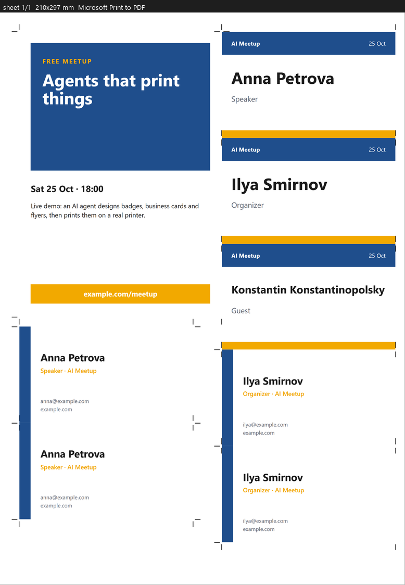

# printshop-mcp

[English](../../README.md) · [Русский](README.ru.md) · [简体中文](README.zh-CN.md) · **Español** · [Português](README.pt-BR.md) · [Deutsch](README.de.md) · [Français](README.fr.md) · [日本語](README.ja.md) · [한국어](README.ko.md) · [Italiano](README.it.md) · [Türkçe](README.tr.md) · [Polski](README.pl.md) · [Українська](README.uk.md) · [العربية](README.ar.md) · [हिन्दी](README.hi.md)

**La imprenta dentro de tu agente de IA.** Pide "acreditaciones para estos 40 invitados, tarjetas de visita y un
flyer": el agente las diseña, las monta en hojas, te muestra una prueba exacta y las imprime en **tu impresora real**
con precisión milimétrica. Y **recuerda todos tus perfiles de impresión**: impresora, papel, bandeja, tipo de soporte,
calidad, perfil de color, calibración e incluso opciones propias del fabricante. Lo explicas una vez y listo.

<p align="center"></p>

> Estado: v0.2, Windows. Novedades: imprimir cualquier PDF (p. ej., de otras skills de diseño) e imposición automática de muchas piezas (`layout`). Próximamente: aprendizaje a partir de defectos, macOS/Linux.

## Compatibilidad con impresoras

**Para impresoras de papel: de inyección de tinta, láser, fotográficas, de sublimación y de etiquetas. No para impresoras 3D.**

Funciona con cualquier impresora que tenga controlador de Windows, sea cual sea la marca: la impresión pasa por el sistema de impresión estándar de Windows y las opciones propias del fabricante (tipo de papel, sin bordes, calidad) se guardan en perfiles mediante la ventana de ajustes del propio controlador.

| Tipo de impresora | Marcas |
|---|---|
| Inyección de tinta | Epson · Canon · HP · Brother |
| Láser y multifunción | HP · Brother · Canon · Kyocera · Xerox · Ricoh · Konica Minolta · Sharp · Lexmark · OKI · Pantum · Samsung |
| Fotográficas (inyección) | Epson · Canon · HP |
| Sublimación (foto) | DNP · Mitsubishi · Citizen · HiTi · Kodak · Canon Selphy |
| Etiquetas / térmicas | Zebra · TSC · Brother QL · Dymo · Xprinter |

Verificado hasta ahora:

| Impresora | Tipo | Estado |
|---|---|---|
| Microsoft Print to PDF | virtual | ✅ todas las pruebas |
| Epson L8050 | inyección de tinta, foto | ✅ bandejas, soportes y márgenes detectados · falta impresión de prueba |

¿Has impreso con otro modelo? [Infórmanos](https://github.com/ildargiv/printshop-mcp/issues/new?template=printer-report.yml) y lo añadimos aquí. macOS y Linux (CUPS) están previstos.

## Instalación

**Claude Code** (skill + servidor MCP en un plugin):

```
/plugin marketplace add ildargiv/printshop-mcp
/plugin install printshop@printshop-mcp
```

**Cualquier cliente MCP** (Claude Desktop, Cursor, Codex...):

```json
{ "mcpServers": { "printshop": { "command": "uvx",
    "args": ["--from", "git+https://github.com/ildargiv/printshop-mcp", "printshop-mcp"] } } }
```

Requiere [uv](https://docs.astral.sh/uv/) y Edge o Chrome (para renderizar).

## ¿Por qué no Ctrl+P?

| Ctrl+P | printshop-mcp |
|---|---|
| "Ajustar a la página" escala sin avisar: 90 mm pasan a 88,7 mm | Renderizado directo a píxeles del dispositivo: 1 mm en CSS = 1 mm en papel |
| El contenido cae en el margen no imprimible | La prueba muestra la zona no imprimible real; la verificación avisa |
| El agente no ve el resultado | Imágenes de prueba + informe JSON: texto cortado, imágenes de baja resolución, papel incorrecto |
| Los ajustes se olvidan cada vez | Perfiles con nombre: estado completo del controlador, calibración e ICC |
| Un solo tipo de pieza por impresión | Acreditaciones, tarjetas y flyers en hojas compartidas con marcas de corte |

## Qué recibe el agente

- **Skill** `skills/printshop`: flujo de trabajo (perfiles → diseño → prueba → impresión → ajuste del perfil), reglas
  HTML, referencia de imposición y plantillas: acreditaciones 90×55, tarjetas 90×50, flyers A6, tarjeta de mesa, hoja mixta.
- **Herramientas MCP**: `list_printers`, `describe_printer`, `list_profiles`, `save_profile` (`open_driver_dialog=true`
  para fijar una sola vez las opciones del fabricante), `layout`, `proof`, `print_job`, `printer_status`.
- **HTML**: cada hoja es `<section class="ps-sheet" style="width:210mm;height:297mm">`, maquetación en mm;
  `data-fit="9pt"` reduce el texto para que quepa; `data-cut` añade marcas de corte.

## Seguridad

Solo se imprime después de `proof`; el trabajo caduca en 1 hora y se imprime una vez. `PRINTSHOP_MAX_SHEETS`
(50 por defecto) limita el papel; `PRINTSHOP_DRYRUN=1` nunca toca la impresora.

Licencia MIT.
